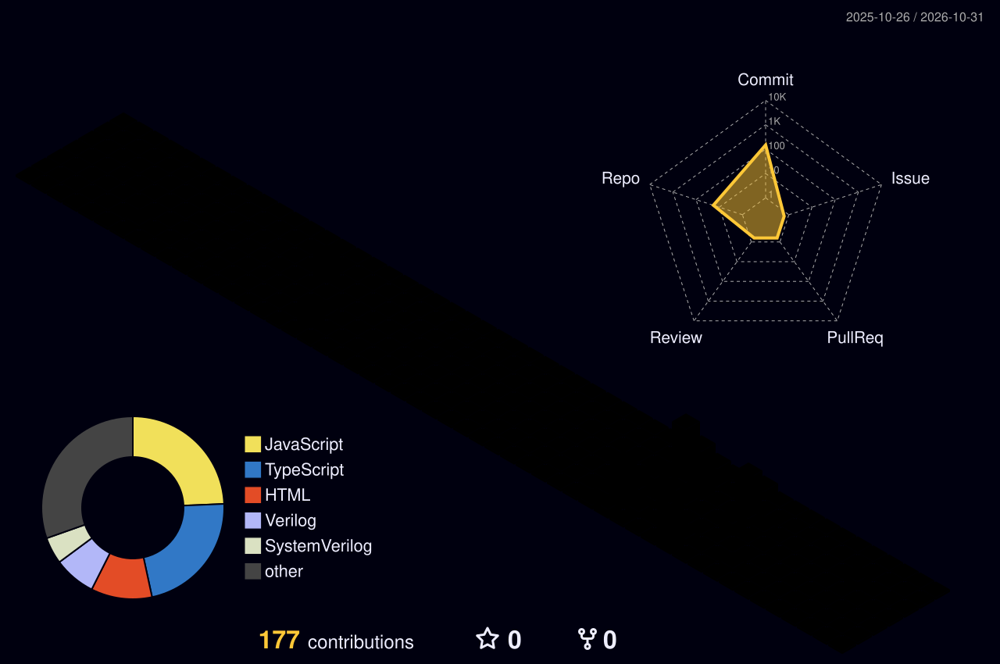

<picture>
  <source media="(prefers-color-scheme: dark)" srcset="https://readme-typing-svg.demolab.com?font=Inter&weight=800&size=36&duration=4000&pause=1000&color=F8FAFC&center=true&vCenter=true&width=700&height=70&lines=Hi%2C+I'm+Ritviz+Aggarwal;Electronics+Engineer;Embedded+and+Digital+Hardware">
  <source media="(prefers-color-scheme: light)" srcset="https://readme-typing-svg.demolab.com?font=Inter&weight=800&size=36&duration=4000&pause=1000&color=0F172A&center=true&vCenter=true&width=700&height=70&lines=Hi%2C+I'm+Ritviz+Aggarwal;Electronics+Engineer;Embedded+and+Digital+Hardware">
  
</picture>

I am an Electronics and Instrumentation Engineering student focused on digital hardware and embedded systems. I design printed circuit boards in Altium, write bare metal C firmware, and build digital logic in Verilog.

I like working close to the hardware: bringing up power rails, debugging buses with an oscilloscope and a logic analyzer, and finding timing problems in simulation. Recently I designed a custom STM32 development board, built a RISC-V processor in Verilog, and turned an NXP FRDM-MCXN236 board into a tilt controlled USB mouse with a Python tuning dashboard.

Alongside projects, I am building lab material for junior engineering students on the ASLKv2010 analog system lab kit.

## My Toolkit

### Hardware & EDA Tools

### Languages

### Research & Tooling

## Hardware projects

| Project | What it is | Tools |
|---|---|---|
| [STM32F411 development board](https://github.com/Rizz-Vizz/stm32f411-dev-board) | Custom 4 layer board with an MPU-6050 IMU. I did the schematic, layout and manufacturing files, then brought up the power rails and wrote bare metal C for I2C communication with the IMU. | Altium Designer, STM32F411, ARM Cortex-M4, C |
| [RISC-V RV32I core](https://github.com/Rizz-Vizz/riscv-rv32i-core) | Single cycle processor with all 47 base instructions, memory mapped UART and GPIO, and a toolchain that runs compiled C programs. Timing problems were found in GTKWave. | Verilog, Icarus Verilog, GTKWave, C |
| [Tilt air mouse](https://github.com/Rizz-Vizz/tilt-air-mouse-mcxn236) | USB HID mouse on an NXP FRDM-MCXN236. Reads an I2C accelerometer, filters it, and turns tilt into cursor movement. A Python dashboard tunes it live. Measured 0 px idle drift and 30 of 30 clicks recognised. | C, ARM Cortex-M33, I2C, USB HID, UART, Python |
| [Hardware neural MAC unit](https://github.com/Rizz-Vizz/Hardware-Neural-MAC) | Multiply accumulate unit and ReLU built from Verilog logic, synthesised and routed for an FPGA and checked with testbenches. | Verilog, Yosys, NextPNR, Icarus Verilog |
| [LED chaser PCB](https://github.com/Rizz-Vizz/LED-Chaser-PCB-Design) | Full Altium flow for a 555 timer and CD4017 circuit: schematic, layout, design rule checks and Gerber files. | Altium Designer |
| [Semiconductor image restoration](https://github.com/Rizz-Vizz/KLArity-Semicon-Restoration-) | Deep learning pipeline that restores degraded semiconductor images, reaching 29.1 dB PSNR. Top placement at the SEMICON India KLA Hackathon. | PyTorch, Python, OpenCV |
| [DSP platform](https://github.com/Rizz-Vizz/dsp-platform) | Real time audio analysis and modification using Fourier analysis, STFT and phase vocoding. [Live demo](https://kymatics.streamlit.app/) | Python |

My web, app and AI projects are on my [portfolio](https://ritviz.netlify.app/).

<!-- 3D chart is off. To turn it on, delete this first line and the matching last line of this block.

## GitHub Activity

<picture>
  <source media="(prefers-color-scheme: dark)" srcset="./profile-3d-contrib/profile-night-rainbow.svg">
  <source media="(prefers-color-scheme: light)" srcset="./profile-3d-contrib/profile-green.svg">
  
</picture>

-->

## Contact Me

